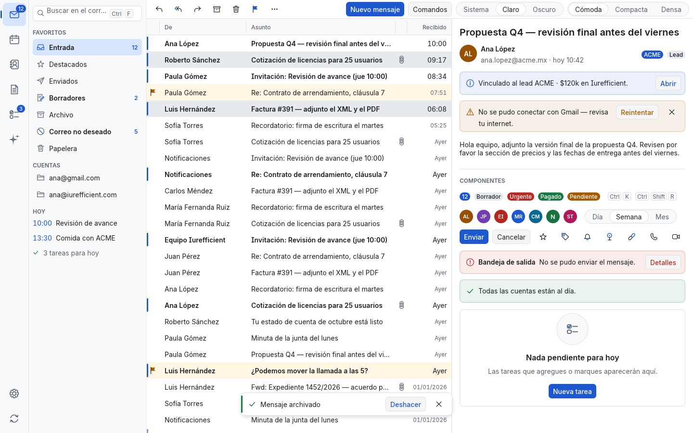
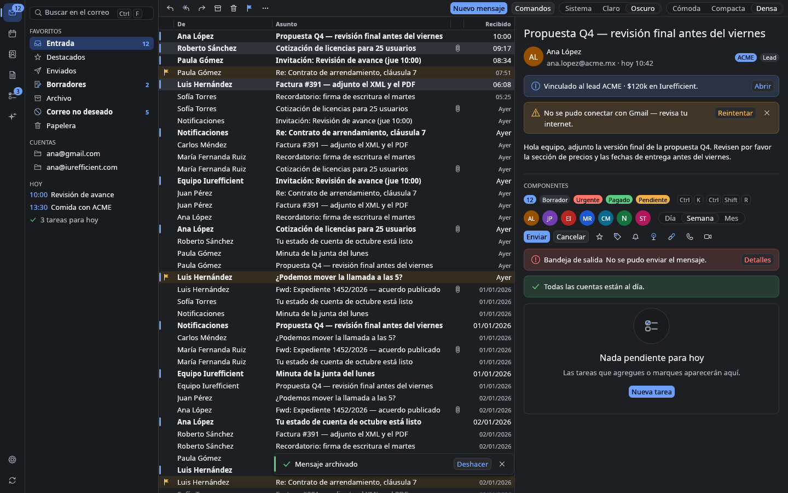
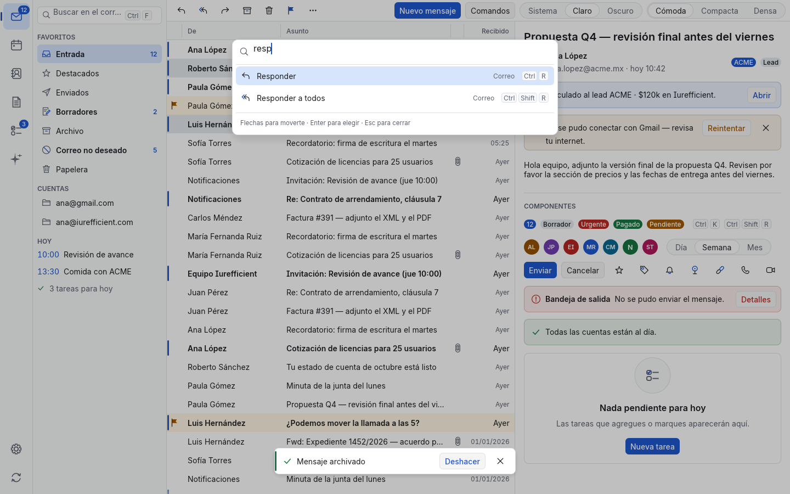

# Iurefficient UI

Kit de interfaz **egui 0.37** compartido por las apps de escritorio de la suite Iurefficient
(IureDesk primero, IureProject después). Rust puro, sin `unsafe`, sin `unwrap` fuera de pruebas,
textos en español e inglés, accesible (AccessKit) y sin activos de Microsoft, Apple ni Google: los
iconos se dibujan en código y la letra es **Inter** (libre, OFL-1.1, incluida en el binario).

Estilo: neutro y tranquilo (grises fríos, un solo acento azul y el marino Iurefficient como
identidad), sin cintas. Tres densidades; en **Densa** las filas miden 22 px.

| Claro, cómoda | Oscuro, densa | Paleta (Ctrl+K) |
|---|---|---|
|  |  |  |

Más capturas en [`docs/`](docs): clara densa, compacta en inglés, alto contraste, paleta oscura y
la hoja de iconos (`icons.png`, `icons-dark.png`); la comparación de fuentes en
[`docs/typography/`](docs/typography).

## Uso

```toml
[dependencies]
iurefficient-ui = { path = "../iurefficient-ui" }   # `portal` y `bundled-fonts` activas por omisión
```

```rust
use iurefficient_ui::{system, theme, Density, ThemeMode};

// Al arrancar:
system::watch_system_theme(&ctx);          // portal XDG en Linux; no hace nada en otros sistemas
system::install_fonts(&ctx, true);         // Inter incluida; la libre del sistema de respaldo
theme::apply(&ctx, ThemeMode::System, Density::Compact);
// En cada cuadro:
theme::refresh(&ctx);                      // si el escritorio cambió de claro a oscuro
```

La galería muestra todo junto (es la mejor referencia de uso):

```sh
cargo run --example gallery                                   # ventana interactiva
cargo run --example gallery -- /tmp/g.png --dark --density dense
cargo run --example gallery -- /tmp/p.png --palette=resp      # con la paleta abierta
cargo run --example gallery -- /tmp/i.png --icons --ppp 2     # hoja de iconos al doble
```

Opciones: `--dark`, `--hc` (alto contraste), `--density comfortable|compact|dense`,
`--lang en|es`, `--palette[=texto]`, `--icons`, `--ppp N`, `--font bundled|system|egui|CARPETA`,
`--no-hint`. Sin ruta abre una ventana (eframe).

## Tipografía

La interfaz usa **Inter 4.1** (Rasmus Andersson, OFL-1.1), con la «I» mayúscula con remates, en cuatro pesos —Regular 400, Medium
500, SemiBold 600 y Bold 700— más una fuente de cifras tabulares. Va dentro del binario
(`include_bytes!`, característica `bundled-fonts`, +1.6 MB), así que la app se ve igual en Linux,
macOS y Windows, tenga o no fuentes instaladas.

**Por qué Inter.** Se compararon en la galería real, claro, densidades Cómoda y Densa, cinco
fuentes libres: Inter 4.1, Geist 1.8.2 (Vercel), IBM Plex Sans 1.1, Source Sans 3.052 (Adobe) y
Noto Sans (la del sistema que se usaba). Capturas en [`docs/typography/`](docs/typography):
[`comparacion-densa.png`](docs/typography/comparacion-densa.png),
[`comparacion-comoda.png`](docs/typography/comparacion-comoda.png),
[`detalle-lista-densa.png`](docs/typography/detalle-lista-densa.png) (1:1) e
[`inter-hinting.png`](docs/typography/inter-hinting.png).

| Fuente | A 12–13 px en lista densa | Cifras | Pesos | Veredicto |
|---|---|---|---|---|
| **Inter** | La más legible: altura de x 0.55 em, formas abiertas, nítida con *hinting* | Proporcionales; `tnum` disponible (se congela aparte) | 9 + variable | **Elegida**: la más cercana a SF Pro, neutra y tranquila; ñ, á, ¿¡ impecables |
| Geist | Buena pero algo más chica y geométrica; se siente «marca Vercel» | Proporcionales | 9 | Segunda; menos glifos (975 vs 2937) |
| IBM Plex Sans | Legible, pero con personalidad («I» con remates, «g», «t» y «a» marcadas): no es calma tipo Apple | Tabulares | 8 | Descartada por carácter; además «Plex» es nombre reservado (no se puede derivar con ese nombre) |
| Source Sans 3 | Altura de x 0.49 em: a igual tamaño se ve chica; habría que subir todo un punto | Tabulares | 7 | Descartada |
| Noto Sans | Correcta pero ancha y sin seminegrita instalada (los no leídos salen en negrita pesada) | Tabulares | 2 instaladas | Queda de respaldo |

**Pesos y familias.** egui no tiene eje de peso, así que cada peso es una familia con nombre:

| Función | Familia | Uso |
|---|---|---|
| `theme::body_font(ctx)`, `small_font(ctx)` | `Proportional` (Inter Regular) | Texto normal |
| `theme::medium_font(ctx, size)` | `system::MEDIUM_FAMILY` | Botón principal, acciones de avisos, insignias, encabezados de columna |
| `theme::semibold_font(ctx, size)` | `system::SEMIBOLD_FAMILY` | No leídos, títulos (`TextStyle::Heading`), nombres, etiquetas de sección, avatares |
| `theme::bold_font(ctx, size)` | `system::BOLD_FAMILY` | Énfasis fuerte (se conserva; antes era el único peso extra) |
| `theme::tabular_font(ctx, size)` | `system::TABULAR_FAMILY` | Horas, fechas, conteos en columnas (`Row::text_muted_tabular`) |

Cada familia cae, en orden, a Inter Regular, a la libre del sistema (Noto/Ubuntu/DejaVu/
Liberation, si está) y a las de egui (símbolos, emoji); sin `install_fonts` todas son la
proporcional de egui y nada se rompe. Escala ajustada a Inter: cuerpo 14 / 13 / 12.5 y títulos
18 / 16 / 15 (Cómoda / Compacta / Densa) en seminegrita.

**Cambiar la fuente.**

```rust
system::install(&ctx, system::FontSource::System);  // la libre del sistema primero (como antes)
system::install(&ctx, system::FontSource::Egui);    // solo las de egui
// Otra familia sin recompilar: carpeta con *-Regular, *-Medium, *-SemiBold, *-Bold (.ttf/.otf)
if let Some(set) = system::FontSet::from_dir(std::path::Path::new("/ruta/fuentes")) {
    system::install_font_set(&ctx, &set, true);   // true: la del sistema de respaldo
}
// Elegible por el usuario (preferencia guardada como texto: `inter`, `system`, `family:…`):
use iurefficient_ui::fonts::{self, FontChoice};
fonts::install_choice(&ctx, &FontChoice::from_key("system")); // la del escritorio (GNOME: portal)
fonts::available_families();       // IBM Plex Sans / Source Sans 3 / Noto Sans instaladas
fonts::find_family("Ubuntu Sans"); // por nombre de familia; fuentes variables con eje `wght`
fonts::set_crisp_text(&ctx, true); // sin subpíxeles y con ajuste horizontal a la rejilla
```

Sin Inter en el binario: `default-features = false, features = ["portal"]`; entonces
`install_fonts(ctx, true)` usa la libre del sistema como antes. Todo archivo de fuente externo se
valida con `skrifa` antes de dárselo a egui (que entra en pánico con uno dañado).

**Límites de egui 0.37.** El texto se forma con `harfrust` y se rasteriza con `skrifa`, pero
`ShapeOptions` no expone funciones OpenType: no se pueden activar `tnum`, `cv11` (a de un piso),
`ss01` (cifras abiertas) ni `cv08` (I con remates). Por eso la «I» mayúscula con remates se
hornea en los cuatro pesos ([`assets/fonts/inter-i-serif.py`](assets/fonts/inter-i-serif.py):
solo la I latina y sus acentuadas, para que «Iurefficient» o «Ilse» no se lean «lurefficient» o
«llse»; antes y después en [`i-mayuscula.png`](docs/typography/i-mayuscula.png), galería con
`--type-sample`) y las cifras tabulares son una fuente aparte (`InterTabular-Regular.ttf`,
~10 KB: subconjunto de Inter con `tnum` congelado, generado por
[`assets/fonts/inter-tabular.py`](assets/fonts/inter-tabular.py)). Las fuentes variables sí
funcionan (`FontTweak::coords`), pero las métricas verticales no siguen al eje (HVAR/MVAR) y la
variable pesa 860 KB por estilo, así que se usan las estáticas con *hinting* TrueType de
`extras/ttf`. egui ajusta a la rejilla por omisión: a 1× se ve más nítido que sin *hinting*
(`--no-hint`, ver `inter-hinting.png`), más parecido a Windows que al suavizado de macOS. No hay
espaciado entre letras: los títulos grandes se compensan con tamaño y peso.

## Módulos

| Módulo | Qué da |
|---|---|
| `tokens` | `brand::{NAVY, NAVY_DARK_THEME, BLUE, GREEN}`; `Palette` con colores semánticos (`bg`, `surface`, `surface_alt`, `text`, `text_muted`, `accent`, `on_accent`, `danger`, `warning`, `success`, `info`, `selection`, `selection_inactive`, `focus`, `separator`, `hover`, `pressed`, `flag_tint`, `brand`) en `LIGHT`, `DARK` y `HIGH_CONTRAST`; `space`, `radius`, `text`; `Density { Comfortable, Compact, Dense }` con `row_height()` (34/28/22), `body_size()`, `small_size()`, `heading_size()`, `icon_size()`, `button_padding()`, `item_spacing()`, `control_height()`, `cell_padding()`, `label()`, `key()/from_key()`. |
| `theme` | `ThemeMode { System, Light, Dark, HighContrast }`; `apply(ctx, mode, density)`, `refresh(ctx)`, `set_density`, `density(ctx)`, `mode(ctx)`; `colors(ui) -> Palette`, `ctx_colors(ctx)`; `body_font`, `small_font`, `medium_font`, `semibold_font`, `bold_font`, `tabular_font` (y sus `*_family`), `use_semibold_headings`; `visuals(&Palette)`, `style_for_density`, `blend`. Prueba de contraste WCAG AA de las tres paletas. |
| `system` | `system_dark()`, `set_system_dark()`, `watch_system_theme(ctx)` (hilo único que consulta `org.freedesktop.appearance color-scheme` cada 2 s y pide un cuadro al cambiar; característica `portal`); `system_font() -> Option<SystemFont>` (solo fuentes libres, por nombre de archivo exacto, con su negrita); `install_fonts(ctx, use_system)` (Inter incluida o la del sistema; registra `BOLD_FAMILY`, `MEDIUM_FAMILY`, `SEMIBOLD_FAMILY`, `TABULAR_FAMILY`); `install(ctx, FontSource)`, `install_font_set(ctx, &FontSet, fallback)`, `FontSet { bundled, system, from_dir, new }`, `FontBytes::is_valid`, `has_family`, `installed_font`; `set_text_scale(ctx, f)` / `clamp_scale` (80–200 %). |
| `icons` | `enum Icon` (119 iconos, cuadrícula 24×24, trazo de 1.6): los de IureProject y los del gestor personal (`Mail`, `Inbox`, `Send`, `Drafts`, `Archive`, `Trash`, `Junk`, `Flag`, `Star`/`StarFilled`, `Reply`, `ReplyAll`, `Forward`, `Attachment`, `Calendar`, `Contacts`, `Person`, `Notes`, `Tasks`, `Check`, `Search`, `Settings`, `Plus`, `MoreHorizontal`, `Chevron*`, `Sparkle`, `Sync`, `Offline`, `Bell`, `Pin`, `Tag`, `Folder`, `Hyperlink`, `Phone`, `Video`, `Close`, `Filter`, `Lock`, `Menu`, `Warning`, `Alert`; de ventana: `Minimize`, `Maximize`, `Restore`). `Icon::ALL`, `Icon::named`, `Icon::name`; `paint(painter, rect, icon, ink, accent)`, `paint_themed`, `icon_button(ui, icon, tip, enabled)`, `menu_item(ui, icon, label)`. |
| `a11y` | `button`, `toggle`, `row` (rol `ListItem`), `area`, `label`: nombre, rol y estado para AccessKit de lo dibujado a mano. |
| `lang` | `Lang { En, Es }`, `lang()`, `set_lang()`, `detect()` (`LC_ALL`/`LC_MESSAGES`/`LANG`, luego `sys-locale` en Windows/macOS), `from_tag()`, `pick(en, es)`. |
| `fuzzy` | `fold` (minúsculas, sin acentos), `score`, `score_with_extra`, `token_score`, `rank`: búsqueda difusa por programación dinámica (inicio de texto y de palabra, letras seguidas, saltos penalizados; acotada a 16 palabras × 32 letras × 256 caracteres). |
| `palette` | `PaletteItem { id, label, hint, shortcut, icon, keywords, enabled }` con constructor encadenable; `CommandPalette` (`open`, `open_with`, `close`, `toggle`, `is_open`, `query`, `cursor`, `handle_shortcut` = Ctrl/⌘+K, `show(ctx, &items) -> Option<String>`); `search(query, items, limit)`. Modal con fondo atenuado, flechas/RePág/AvPág, Enter, Esc o clic fuera. |
| `list` | `ListView::new(id, &mut columns, rows).row_height(h).header(b).label(s).show(ui, &mut ListState, key_of, paint_row) -> ListResponse { sort, selection_changed, activated, context, visible, response }`. `Column` (`fixed`, `not_sortable`, `right`, `grow`, `min_width`; ancho arrastrable), `SortDir`, `ListState` (`selection`, `sort`, `scroll_to`), `Selection` por clave estable `u64` (`click`, `move_to`, `toggle_cursor`, `select_all`, `clamp`), `Row` (`style(RowStyle { unread, flagged, muted })`, `text`, `text_muted`, `text_muted_tabular`, `text_with`, `text_in`, `icon`, `icon_colored`, `cell`, `painter`, `describe`). Solo pinta las filas visibles; prueba con 200 000 filas. |
| `widgets` | `nav_rail(ui, &[NavItem], selected) -> Option<&str>` y `rail_width(ctx)`; `sidebar_item(ui, icon, label, count, selected)`; `split::{left, right, top_bar, bottom_bar, center, frame, PaneKind}`; `badge`, `count_badge`, `paint_badge`, `BadgeKind`; `avatar(ui, name, email, d)`, `initials`, `avatar_color` (FNV-1a del correo, 10 colores AA); `Banner::new(Severity, text).title().action().dismissible().show(ui)` y `Toasts` (`push`, `show(ctx) -> Option<id>`, caducan solas); `EmptyState::new(icon, title).body().action().show(ui)`; `segmented(ui, &mut value, &[(v, label)])`; `SearchField::new(&mut s).hint().shortcut().show(ui)` (Esc vacía, botón ×, atajo como tecla); `keycap(ui, "Ctrl+K")`, `paint_shortcut`; `text::elided`; `primary_button`, `section_label`. |

Los nombres más usados se reexportan en la raíz (`iurefficient_ui::{Icon, Density, ThemeMode, pick, …}`).

## Calidad

```sh
cargo fmt --check && cargo clippy --all-targets -- -D warnings && cargo test
```

- Pruebas unitarias: búsqueda difusa, selección (clic, Mayús, Ctrl, teclado), anchos de columna,
  contraste AA de paletas, insignias y avatares, iniciales, fuentes libres, caducidad de avisos,
  fuentes (Inter carga con sus cuatro pesos y cifras tabulares de verdad, archivos dañados se
  rechazan sin pánico, y sin `bundled-fonts` todo sigue funcionando:
  `cargo test --no-default-features`).
- `tests/widgets.rs` (egui_kittest con wgpu): paleta (Ctrl+K, escribir, flechas, Enter, clic, Esc,
  deshabilitados), lista de 200 000 filas (solo ~17 filas pintadas por cuadro, 60 páginas en < 5 s,
  Fin/Inicio, Ctrl+A, Mayús/Ctrl+clic, ordenar por encabezado) y capturas de referencia en
  `tests/snapshots/` (`UPDATE_SNAPSHOTS=1 cargo test` para regenerarlas). El arnés de kittest
  verifica además que todo control tenga nombre accesible.
- Las pruebas que renderizan se turnan (un `Mutex`): algunos controladores fallan con dos
  dispositivos wgpu a la vez.

## Plan de migración de IureProject

IureProject está en egui 0.36; primero sube a **0.37** (cambios que se encontraron aquí:
`Id::new` → `Id::unique` / `IdSalt::new`, `WidgetType` → `Role` (`SelectableLabel` ya no existe:
`Role::Button` con `selected`), `Atom::custom` recibe `IdSalt`, `scroll_area::State::offset` →
`clamped_offset()`, `SidePanel`/`TopBottomPanel` → `egui::Panel::{left,right,top,bottom}(…).show(ui, …)`,
y kittest revisa nombres accesibles por omisión). Después, módulo por módulo:

| IureProject | iurefficient-ui | Notas |
|---|---|---|
| `crates/render/src/tokens.rs` (`brand`, `space`, `radius`, `text`) | `tokens` | `render` conserva su paleta del Gantt (la usa también la web, sin egui). Los `color::*` sueltos pasan a `Palette`. |
| `ui-egui/src/theme.rs` | `theme::colors(ui)` | `text→c.text`, `weak→c.text_muted`, `accent→c.accent`, `brand→c.brand`, `grid→c.separator`, `selection→c.selection`, `DANGER/SUCCESS→c.danger/c.success`, `warning→c.warning`; `highlight` (filtro «Resaltar») se queda local o usa `flag_tint`. |
| `ui-egui/src/icons.rs` | `icons` | Mismo `enum` y mismos nombres; `Icon::of_command(id)` queda en IureProject como función de una línea (`find(id).and_then(\|c\| Icon::named(c.icon))`). |
| `ui-egui/src/prefs.rs` | `system` + `theme` | `system_dark`, `watch_system_theme`, `portal_dark`, `system_font`, `find` → `system`; `polished`/`high_contrast` → `theme::visuals`; `Prefs::apply_theme` → `theme::apply(ctx, ThemeMode, Density)`. La persistencia (`preferencias.json`) se queda en la app; `ThemeMode::from_key` ya acepta «claro»/«oscuro»/«alto_contraste». Agregar la densidad a Opciones. |
| `ui-egui/src/a11y.rs` | `a11y` | Igual, más `label`; `row` ahora anuncia `ListItem`. |
| `ui-egui/src/palette.rs` | `palette` + `fuzzy` | `fold`/`score` → `fuzzy` (ranking mejor: iniciales y letras seguidas). `entries()` de IureProject construye `PaletteItem` (id = `ribbon:<act>`, `file:<page>`, `task:<uid>`, `filter:<n>`) y `run()` traduce el id devuelto a `Target`. |
| `ui-egui/src/sheet.rs` (filas, selección) | `list` (parcial) | La hoja tiene edición en celda y esquema; se reutilizan `Selection` (por `TaskUid`) y `widgets::text::elided`. Vistas de solo lectura (uso, recursos) pueden pasar a `ListView`. |
| `engine/src/lang.rs` | `lang` | El motor (L4) no puede depender de egui, así que conserva su `lang`; la UI llama a los dos `set_lang` al cambiar el idioma. |
| `ribbon.rs`, `backstage.rs`, Gantt y demás vistas | — | Se quedan en IureProject; usan `theme::colors`, `icons` y los controles pequeños (`Banner`, `segmented`, `SearchField`, `EmptyState`). |

Orden sugerido: (1) egui 0.37; (2) `tokens`/`theme`/`icons`/`a11y` (cambio mecánico, capturas
`ui_shot` antes y después); (3) `system` + densidades en Opciones; (4) paleta; (5) vistas de solo
lectura con `ListView`.

## Pendientes conocidos

- Sin columnas reordenables por arrastre ni desplazamiento horizontal en `ListView` (la columna
  `grow` absorbe el ancho); sin filas de altura variable.
- El cursor y el ancla de la selección son índices: si llegan filas nuevas arriba, la app debe
  mover el cursor (las claves seleccionadas sí se conservan).
- Precisión `f32`: listas de más de ~5 millones de filas pierden exactitud al desplazarse.
- `watch_system_theme` consulta el portal cada 2 s en vez de suscribirse a `SettingChanged`.
- Los glifos que no estén en la fuente (p. ej. flechas «↑») se ven como cajas; los textos de la
  interfaz evitan esos caracteres.

## Licencia

FSL-1.1-ALv2 ([LICENSE.md](LICENSE.md), [NOTICE](NOTICE)), titular Eduardo Llaguno Velasco.
